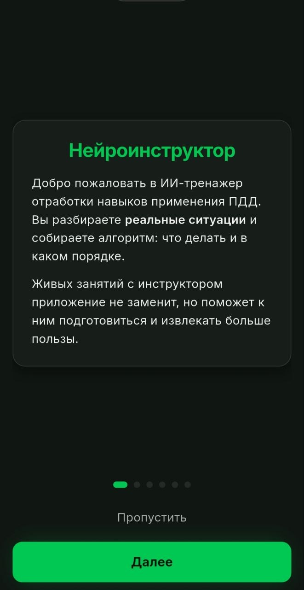
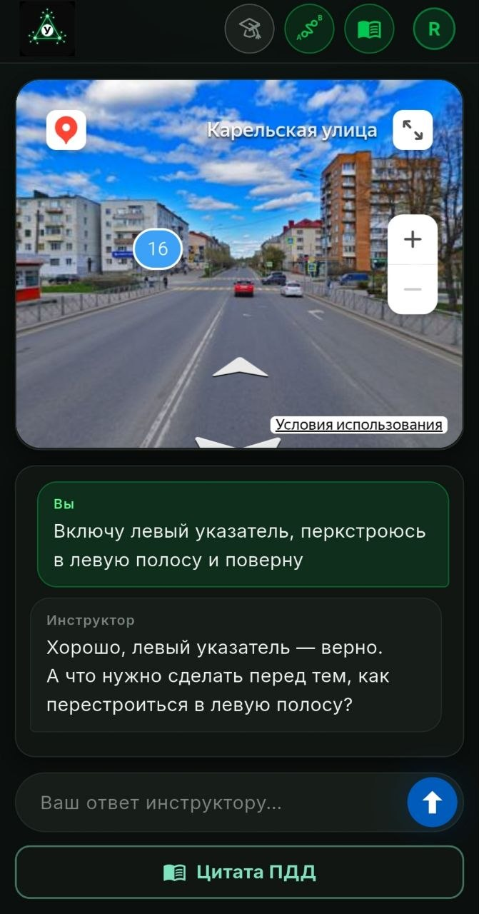
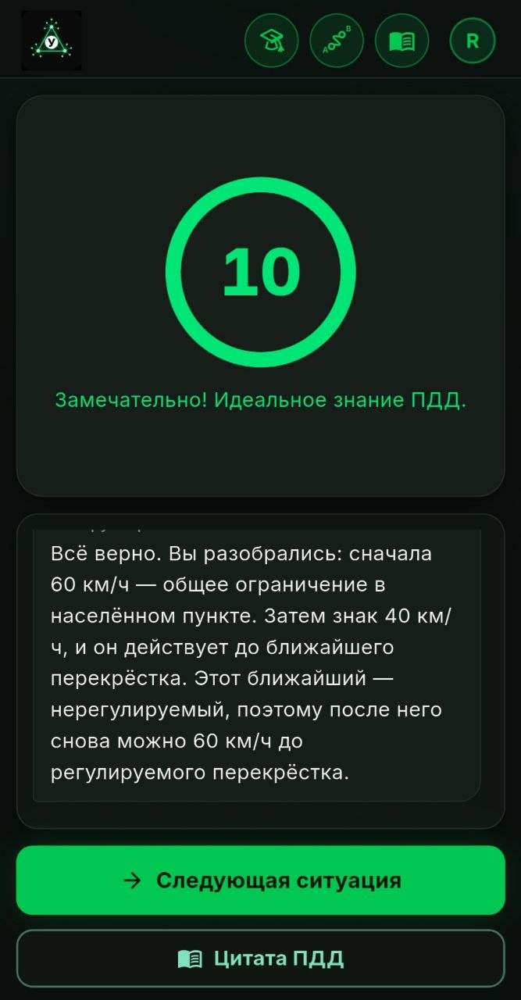
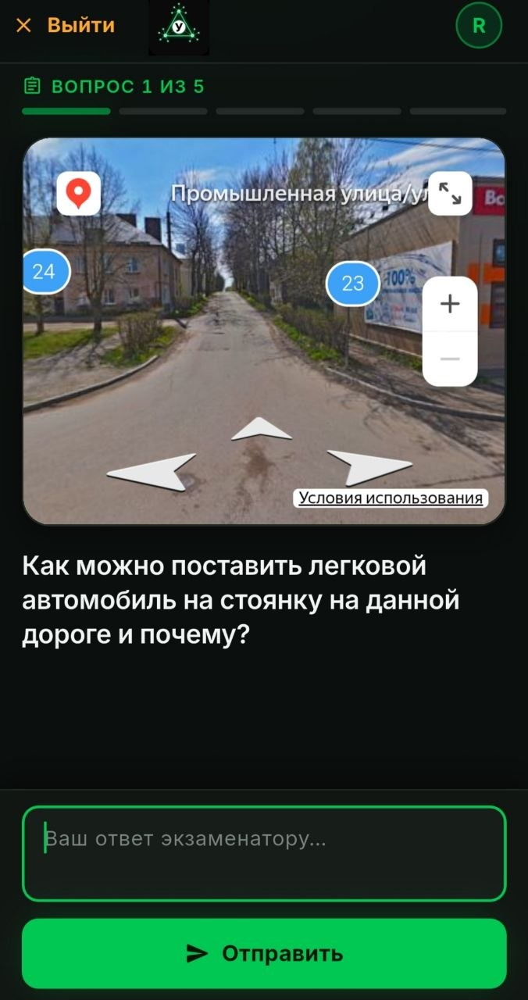
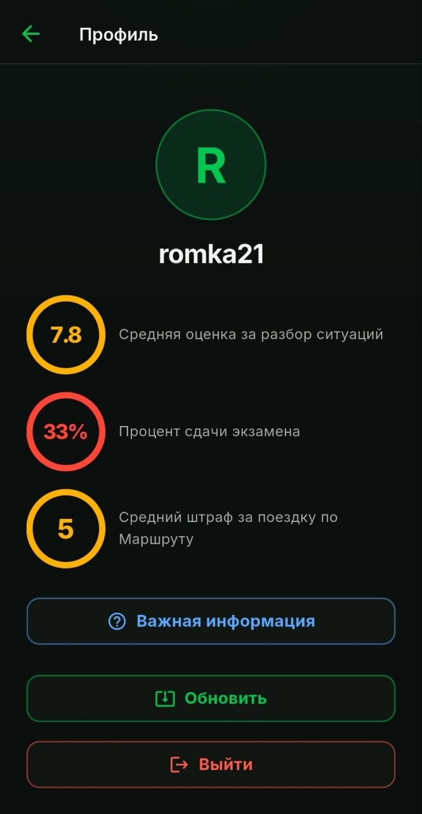
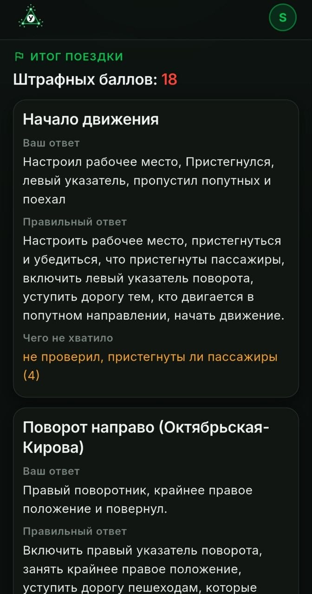
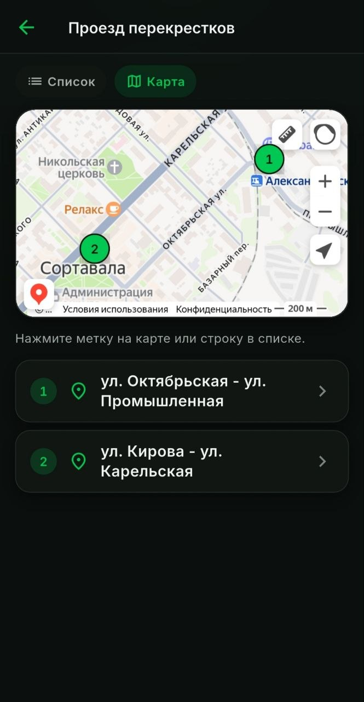
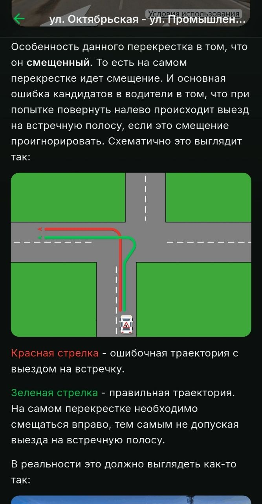
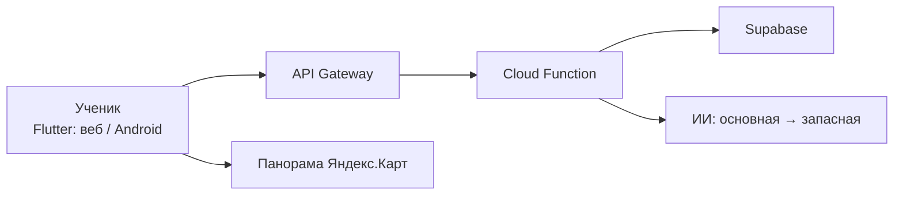

  

# Нейроинструктор

Тренажёр ПДД с ИИ-инструктором: ученик смотрит **реальную панораму улицы** и отвечает текстом или голосом. Не билеты из книжки — разбор ситуации, как на занятии.

Живой продукт: [app.adr-academy.ru](https://app.adr-academy.ru) · Android и веб.

Собран вайбкодингом в Cursor: я описываю, что должен увидеть ученик, агент пишет код, я проверяю на телефоне и в браузере и возвращаю правку. Первый коммит — август 2026, к октябрю в проде тренировка, экзамен, маршрут и памятка.

Исходный код закрыт: это рабочий продукт школы, не шаблон. Здесь — описание и скриншоты. Вход по логину, который заводит школа.

---

## Скриншоты

  
  
  
  

  
  
  
  

| | |
| --- | --- |
| Онбординг | Тренировка: панорама и чат с инструктором |
| Оценка 0–10 после разбора | Экзамен: один ответ на карточку |
| Профиль со статистикой | Финиш маршрута: свой ответ, эталон, штрафы |
| Памятка: карта перекрёстков | Статья с схемой манёвра |

---

## Зачем это

Автошкола учит правилам по билетам. На дороге билетов с вариантами ответов нет. Нейроинструктор показывает ученику панораму из Яндекс.Карт и задаёт вопрос о конкретной дорожной ситуации (как проехать перекрёсток, где можно припарковаться, какой скоростной режим) и ведёт разбор **вопросами**, заставляя ученика самостоятельно формулировать правильный алгоритм действий. Пропустил шаг — не закрывает занятие. Дал правильный ответ с первого раза — десятка.

Модель панораму не видит. Что в кадре — написано в промпте карточки. Отсюда половина работы: не «подключить GPT», а научить модель спрашивать по ПДД так, чтобы оценка была честной.

---

## Что видит ученик

| Занятие | Как устроено |
| --- | --- |
| **Тренировка** | Панорама сверху, чат снизу. Инструктор спрашивает по скрипту. В конце оценка **0–10**. Ноль — пауза на час, можно читать памятку. |
| **Экзамен** | Пять карточек, один ответ на каждую, сдал / не сдал. Открывается после пяти разобранных тренировок. |
| **Маршрут** | Поездка по точкам: кадр, команда инструктора, один ответ. По дороге ни баллов, ни эталона. На финише таблица штрафных баллов в логике экзаменационного листа ГИБДД. |
| **Памятка** | Статьи школы, картинки, карта перекрёстков. ИИ не вызывается. |

В профиле статистика: средняя оценка за разбор, процент сдачи экзамена, средний штраф за маршрут. На Android — кнопка «Обновить»: приложение само скачивает новую сборку.

Голосовой набор: удерживаешь микрофон и говоришь, текст падает в поле. Отправляет ученик сам, после проверки.

---

## Стек

| Слой | Что |
| --- | --- |
| Клиент | **Flutter** — один код на Android и веб |
| Панорамы | виджет **Яндекс.Карт** (WebView / iframe), не скриншот |
| API | **Python**, Yandex Cloud Functions + API Gateway |
| База | **Supabase** (Postgres): ученики, ситуации, сессии, промпты, памятка |
| ИИ | диалог / экзамен / маршрут — модель через прокси; тишина или отказ — повтор, затем запасная. Ответ ученику — только реплика инструктора |
| Контент | промпты ситуаций и маршрутов лежат в БД, клиент не пересобираем |
| Деплой | веб и APK в Object Storage; тестовый канал и боевой — разные папки |

Песочница на Streamlit — мой рабочий стол: прогнать диалог, залить промпт, посмотреть историю ученика и жалобу на оценку. Ученик её не видит.

---

## Как я это собираю

Я вайбкодер. Код продукта пишут агенты Cursor. Моя работа — другая:

1. **Продукт.** Что ученик нажимает, что нельзя показывать до финиша, каким языком говорит инструктор («уступить дорогу», не «уступка»).
2. **Правила для агента.** Живой снимок проекта в рабочей копии. Новый чат начинается с него. История в git, в снимке только текущая правда. Отдельные правила — куда заливать сборку, чтобы тестовый канал не уехал ученикам.
3. **Промпты.** Скелет роли + карточка ситуации. Чеклист: пункт закрывают только слова ученика. Модель любит договорить за него и поставить зачёт — это ловим тестами и прогонами, не «надеждой на GPT».
4. **Приёмка.** Смотрю экран, а не дифф. Сломалась панорама на Android, клавиатура на веб-телефоне, двойной kickoff модели, оценка записалась в чат, но не в базу — это всё уже было в проде и чинилось тем же циклом: описал симптом → агент чинит → проверяю.

Так из чатов с агентом получился не лендинг, а сервис со школой, очередью, лимитом вызовов ИИ, двумя каналами поставки и обновлением APK с телефона.

---

## Где было тесно

Это не «CRUD + чат-виджет». Места, которые пришлось выстрадать, а не сгенерировать с первой попытки:

- **Честный зачёт.** Добиться, чтобы модель строго следовала чек-листу и не закрывала диалог с дырами, было непросто.
- **Панорама на телефоне.** Обычная текстура WebView замирает. Нужен hybrid composition и нельзя выкидывать вид из дерева, когда поверх онбординг.
- **Модель живая.** Молчит, пишет латинский мусор в реплику, повторяет первую фразу дважды, забывает JSON-статус на маршруте. Цепочка: повтор → запасная модель → ученику 503, а не пустой пузырь.
- **Прод между облаками.** Большой UPDATE сессии в Supabase иногда полз секундами. Запись хода ужали до маленького RPC; не записалось — ученик видит «отправьте ещё раз», а не фальшивую оценку.

---

## Архитектура

Клиент не знает промпта и эталона. Пока поездка не кончилась, в JSON только то, что можно показать на экране.

---

## Ссылки

- Приложение: [app.adr-academy.ru](https://app.adr-academy.ru)
- Эта витрина: [github.com/Sibarit87/neuroinstructor](https://github.com/Sibarit87/neuroinstructor)
